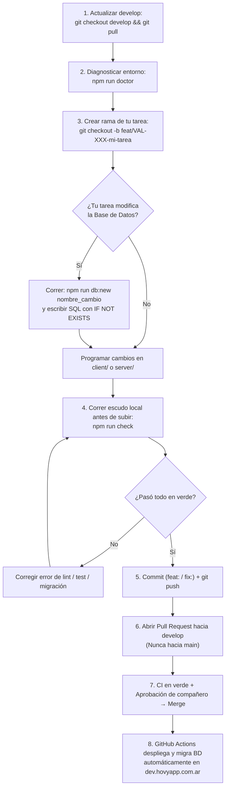

# Guía Oficial para Desarrolladores — Flujo de Trabajo, Herramientas y Pipelines (Hovy)

> **Propósito de este documento:** Que todo el equipo de desarrollo de **Hovy** conozca qué herramientas automatizadas tenemos en el repositorio, cómo usarlas en el día a día y qué reglas seguir para que ningún Pull Request ni despliegue a Staging/Producción falle en GitHub Actions.

---

## 1. ¿Cómo funciona hoy la arquitectura de despliegue de Hovy?

El proyecto cuenta con un pipeline **CI/CD y DevSecOps 100% automatizado** dividido en tres entornos:

| Entorno | Rama Git | URL | Base de Datos Supabase | ¿Qué pasa cuando se hace Merge? |
| :--- | :--- | :--- | :--- | :--- |
| **Local** | `feat/VAL-XXX-...` | `http://localhost:5173` (Front)<br>`http://localhost:4000` (API) | Staging (o local) | Programás y probás con `npm run dev` y `npm run check`. |
| **Staging (Dev)** | `develop` | `https://dev.hovyapp.com.ar` | Proyecto **Hovy Staging** (`kzfziqdmtvrcwotemvyj`) | GitHub Actions compila el proyecto, actualiza el contenedor en Azure, **ejecuta automáticamente las migraciones SQL nuevas**, verifica `/api/health` y, si algo falla, vuelve atrás solo (**Auto-Rollback**). |
| **Producción** | `main` | `https://hovyapp.com.ar` | Proyecto **Hovy Prod** (`dulaaxavsvgkqqbrvltd`) | GitHub Actions genera un **backup automático preventivo** de toda la BD de Producción, aplica las migraciones SQL pendientes, actualiza el contenedor, verifica `/api/health` y publica el **Release SemVer (`vX.Y.Z`)**. |

---

## 2. Caja de Herramientas del Desarrollador (Comandos Rápidos)

Desde la **raíz del repositorio (`Hovy/`)**, tenés disponibles los siguientes comandos para no renegar con configuraciones ni romper el pipeline:

| Comando | ¿Para qué sirve? | ¿Cuándo usarlo? |
| :--- | :--- | :--- |
| **`npm run doctor`** | **Diagnóstico del entorno local.** Revisa en 1 segundo tu versión de Node.js, si tenés instalados los `node_modules` de `client` y `server`, y si te falta alguna variable nueva en tu `server/.env` comparándolo contra `server/.env.example`. | Cada vez que hacés `git pull origin develop` y algo no te levanta en local. |
| **`npm run check`** | **Simulador completo del CI local.** Ejecuta de un solo golpe: verificador de migraciones SQL + Linter de React (`eslint`) + Build de Vite + los 80 tests automatizados del backend. | **SIEMPRE antes de hacer `git push` o abrir un Pull Request.** Si `npm run check` pasa en verde en tu PC, el PR va a pasar en verde en GitHub. |
| **`npm run db:new <nombre>`** | **Creador automático de migraciones SQL.** Calcula el próximo número correlativo (ej. `010`), crea el archivo `.sql` con plantilla segura en `docs/migrations/` y lo agrega automáticamente a la tabla de `docs/migrations/README.md`. | Cada vez que tu historia de usuario requiera crear/modificar una tabla, columna, vista, función o trigger en Supabase. |
| **`npm run db:status`** | Muestra qué migraciones (`001`, `002`, ...) ya están aplicadas en la base de datos y cuáles están pendientes. | Cuando querés verificar si tu base de datos configurada en `server/.env` está al día. |
| **`npm run db:migrate:dry`** | Simula qué migraciones pendientes se ejecutarían mostrando su huella `SHA-256`, sin modificar la base de datos. | Antes de correr `npm run db:migrate`. |
| **`npm run db:migrate`** | Aplica en una transacción atómica todas las migraciones `.sql` pendientes contra la base configurada en tu `server/.env`. | Cuando creaste una migración nueva con `npm run db:new` y querés aplicarla desde tu consola, o cuando el pipeline despliega a Staging/Producción. |
| **`npm run db:verify`** | Verifica offline que todos los archivos `.sql` respeten la numeración correlativa (`000_`, `001_`, ...) y estén documentados en `docs/migrations/README.md`. | Se corre solo dentro de `npm run check`, o manualmente cuando agregás un `.sql`. |
| **`npm run db:drift`** | Compara columna por columna el esquema de Staging contra el de Producción para confirmar que ambas bases sean 100% idénticas. | Auditoría de paridad antes de un pase a Producción (`main`). |

---

## 3. Metodología de Trabajo para Base de Datos (¡Muy Importante!)

### ¿Por qué cambió nuestra forma de tocar Supabase?
Si alguien agrega una columna o tabla manualmente desde el botón **"Table Editor"** de la página web de Supabase en Staging pero no deja el script `.sql` en el repositorio:
1. Sus compañeros no se enteran del cambio.
2. Cuando ese código llega a Producción (`main`), **Producción da Error 500** porque en la base de datos de Producción esa columna o tabla no existe (esto se llama *Schema Drift*).

### Cómo hacer cambios en la Base de Datos en 3 pasos simples

#### Paso 1: Generar el archivo con el comando automático
Parate en la raíz del proyecto y ejecutá:
```bash
npm run db:new agregar_telefono_alternativo_clientes
```
Esto va a crear automáticamente:
- El archivo `docs/migrations/010_agregar_telefono_alternativo_clientes.sql` (con el número que corresponda sin que tengas que adivinarlo).
- La fila correspondiente en la tabla de `docs/migrations/README.md`.

#### Paso 2: Escribir SQL idempotente (a prueba de re-ejecuciones)
Abrí el archivo `.sql` que se creó y escribí tus sentencias usando **siempre cláusulas defensivas (`IF NOT EXISTS` / `IF EXISTS`)**:

✅ **BIEN HECHO (Idempotente — Nunca falla si se corre dos veces):**
```sql
-- Agregar columnas nuevas
ALTER TABLE public.clientes
  ADD COLUMN IF NOT EXISTS telefono_alternativo VARCHAR(30),
  ADD COLUMN IF NOT EXISTS observaciones TEXT;

-- Crear una tabla nueva
CREATE TABLE IF NOT EXISTS public.notificaciones_enviadas (
  id_notificacion BIGSERIAL PRIMARY KEY,
  id_usuario BIGINT NOT NULL REFERENCES public.usuarios(id_usuario) ON DELETE CASCADE,
  fecha_envio TIMESTAMPTZ NOT NULL DEFAULT NOW()
);

-- Eliminar una columna obsoleta
ALTER TABLE public.presupuestos
  DROP COLUMN IF EXISTS columna_vieja;

-- Crear o actualizar una función
CREATE OR REPLACE FUNCTION public.mi_funcion() ...
```

❌ **MAL HECHO (Rompe el pipeline si la columna o tabla ya existía):**
```sql
ALTER TABLE public.clientes ADD COLUMN telefono_alternativo VARCHAR(30);
CREATE TABLE public.notificaciones_enviadas (...);
```

#### Paso 3: Aplicar y subir en tu Pull Request
- Si querés aplicarla desde tu consola en Staging mientras desarrollás:
  ```bash
  npm run db:migrate
  ```
- Incluí en tu commit tanto el archivo `docs/migrations/010_...sql` como `docs/migrations/README.md`.
- Cuando tu PR se apruebe y se mergee a `develop` (y luego a `main`), **el robot de GitHub Actions la aplicará automáticamente en Staging y en Producción**.

---

### Las 3 Reglas de Oro de las Migraciones SQL

1. **Prohibido tocar el Table Editor de Supabase "en silencio":** Todo cambio en tablas, columnas o triggers tiene que tener su archivo `.sql` creado con `npm run db:new`.
2. **Regla de Inmutabilidad (Nunca edites una migración vieja):**
   Una vez que una migración (`001_` a `009_`) ya fue mergeada a `develop`, **jamás le cambies el código ni el nombre**. El motor guarda en la tabla `public.schema_migrations` el hash criptográfico (`SHA-256`) de cada archivo aplicado; si modificás un archivo viejo, el pipeline detecta la alteración y bloquea el despliegue. Si necesitás corregir algo de una tabla anterior, simplemente corré `npm run db:new correccion_tabla_x` y creá la migración siguiente.
3. **Prohibido usar `DROP DATABASE` o `TRUNCATE` sin control:** El verificador automático del CI escanea el contenido de los `.sql` y rechaza sentencias destructivas masivas.

---

## 4. Guía de los 5 Checks de GitHub Actions: ¿Por qué fallan y cómo arreglarlos?

Cada vez que abrís o actualizás un Pull Request hacia `develop` o `main`, GitHub ejecuta **5 controles automáticos**. Las ramas `develop` y `main` están protegidas (**Branch Protection Rules**), por lo que **GitHub bloquea el botón de Merge hasta que estén en verde**.

### 1️⃣ `Client (lint + build)`
- **¿Qué revisa?**
  - Que no haya vulnerabilidades altas/críticas en paquetes de `client/package.json` (`npm audit`).
  - Que el código React cumpla las reglas de ESLint (`npm run lint`).
  - Que el proyecto compile para producción con Vite (`npm run build`).
- **Causas comunes de fallo:**
  - Dejaste una variable o `import` declarado que no se usa en ningún lado (`'x' is assigned a value but never used`).
  - Importaste un archivo con mayúsculas/minúsculas distintas al nombre real del archivo (en Windows funciona porque no distingue mayúsculas, pero en el servidor Linux de GitHub falla el `build`).
- **Cómo probarlo en tu PC:**
  ```bash
  npm --prefix client run lint
  npm --prefix client run build
  ```

### 2️⃣ `Server (install + syntax check)`
- **¿Qué revisa?**
  - Que todos los archivos `.js` de `server/src/` tengan sintaxis válida (`node --check`).
  - Que pasen los **80 tests automatizados** del backend (`npm --prefix server test`), incluyendo tests unitarios, de integración HTTP y de esquemas Zod.
- **Causas comunes de fallo:**
  - Cambiaste la respuesta, el código de estado HTTP (`200`, `201`, `400`) o una validación de un endpoint existente y no actualizaste su test correspondiente en `server/src/test/`.
- **Cómo probarlo en tu PC:**
  ```bash
  npm --prefix server test
  ```

### 3️⃣ `Database Migrations & IaC Governance`
- **¿Qué revisa?**
  - Corre `node scripts/verify-migrations.mjs` para validar que todos los `.sql` de `docs/migrations/` tengan formato `NNN_nombre.sql`, sin números repetidos ni salteados, y que figuren en `docs/migrations/README.md`.
  - Valida la sintaxis de los scripts de infraestructura (`infra/scripts/*.sh`) y del servidor inverso Nginx (`infra/nginx/hovy.conf`).
- **Causas comunes de fallo:**
  - Creaste un archivo `.sql` a mano y te olvidaste de agregarlo en `docs/migrations/README.md`, o dos ramas crearon el mismo número de migración.
- **Cómo evitarlo / arreglarlo:**
  - Usá siempre `npm run db:new <nombre>` y verificá con `npm run db:verify`.

### 4️⃣ `DevSecOps (Gitleaks + Trivy Scan)`
- **¿Qué revisa?**
  - **Gitleaks:** Escanea todo el historial de tus commits buscando contraseñas, tokens de Mercado Pago, claves `service_role` de Supabase o archivos `.env` subidos por accidente.
  - **Trivy:** Construye la imagen Docker real del proyecto y escanea el sistema operativo Alpine y las librerías de Node buscando fallas de seguridad (`HIGH` / `CRITICAL`).
- **Causas comunes de fallo:**
  - **¡Subir credenciales o claves reales en el código o en un commit!** (Incluso si las subiste en un commit y las borraste en el commit siguiente, Gitleaks revisa el historial de commits del PR y lo detecta).
- **Regla de Oro:**
  - **NUNCA** escribas claves reales en archivos `.js`, `.mjs` ni `.md`. Usá siempre `process.env.MI_VARIABLE` y poné un valor de ejemplo falso en `server/.env.example`.

### 5️⃣ `CodeQL (JavaScript / TypeScript)`
- **¿Qué revisa?**
  - Es el motor oficial de análisis estático de seguridad (SAST) de GitHub. Busca vulnerabilidades en el código como inyecciones SQL, Cross-Site Scripting (XSS), redirecciones abiertas o configuraciones inseguras de cabeceras HTTP.

---

## 5. Flujo Completo de punta a punta para desarrollar una tarea



### Resumen de comandos para copiar y pegar en tu día a día

```bash
# 1. Antes de arrancar una tarea nueva:
git checkout develop
git pull origin develop
npm run doctor
git checkout -b feat/VAL-XXX-descripcion-corta

# 2. (Solo si necesitás crear/modificar tablas o columnas en Supabase):
npm run db:new descripcion_del_cambio_sql
# -> Editás el archivo creado en docs/migrations/NNN_descripcion_del_cambio_sql.sql
# -> Si querés aplicarlo ya en tu BD configurada en server/.env:
npm run db:migrate

# 3. Antes de hacer git push (¡Obligatorio!):
npm run check

# 4. Subir tus cambios usando Conventional Commits:
git add .
git commit -m "feat(presupuestos): agregar filtro por estado de cobro"
git push -u origin feat/VAL-XXX-descripcion-corta
```

---

## 6. Convención de Nombres de Commits y Ramas

Usamos **Conventional Commits** porque el pipeline de `Release & Changelog Automation` los lee automáticamente cuando pasamos a Producción (`main`) para calcular el número de versión:

- `feat: ...` o `feat(modulo): ...` ➡️ Funcionalidad nueva (sube versión **MINOR**, ej. `v1.0.0` → `v1.1.0`).
- `fix: ...` o `fix(modulo): ...` ➡️ Corrección de un bug (sube versión **PATCH**, ej. `v1.1.0` → `v1.1.1`).
- `docs: ...` ➡️ Cambios solo en documentación.
- `test: ...` ➡️ Agregar o corregir tests.
- `chore: ...` / `ci: ...` ➡️ Mantenimiento de dependencias o configuración.

---

## 7. ¿Qué pasa si agrego una Variable de Entorno nueva?

Si tu código necesita una nueva variable en `server/.env` (por ejemplo, `NUEVA_API_TIMEOUT=5000`):
1. Agregala en tu `server/.env` local para probar.
2. **Obligatorio:** Agregá el nombre de la variable (con un valor de ejemplo, **sin secretos reales**) en `server/.env.example`. Así, cuando tus compañeros corran `npm run doctor`, la herramienta les avisará automáticamente qué variable nueva tienen que agregar en su `.env`.
3. Avisale a **Emiliano (`@Nailiyo`, DevOps)** antes de mergear el PR para que la deje configurada en el servidor de Azure (`Staging` y `Producción`).
